# bombgrid

Turns your GitHub contribution graph into a tiny animated Bomberman level. A character walks the board, drops
bombs, and blows up your commit blocks one by one. The result is a plain SVG (CSS + SMIL, no scripts, no GIF), so it
works inside a profile README.

<picture>
  <source media="(prefers-color-scheme: dark)" srcset="assets/bombgrid-dark.svg">
  
</picture>

## Quick start

1. In your profile repository (the one named like your username) add `.github/workflows/bombgrid.yml`:

   ```yaml
   name: Generate bombgrid
   on:
     schedule:
       - cron: "0 0 * * *"
     workflow_dispatch:
   permissions:
     contents: write
   jobs:
     generate:
       runs-on: ubuntu-latest
       steps:
         - uses: actions/checkout@v7
         - uses: pachara-n/bombgrid@v1
           with:
             github_user_name: ${{ github.repository_owner }}
             outputs: |
               dist/bombgrid.svg
               dist/bombgrid-dark.svg?palette=dark
         # then publish dist/ to an `output` branch: see examples/profile-workflow.yml for the full file
   ```

   The complete, ready to copy file is [examples/profile-workflow.yml](examples/profile-workflow.yml).

2. Run the workflow once from the **Actions** tab (**Run workflow**).
3. Add the images to your profile `README.md`:

   ```html
   <picture>
     <source
       media="(prefers-color-scheme: dark)"
       srcset="https://raw.githubusercontent.com/YOUR_NAME/YOUR_NAME/output/bombgrid-dark.svg"
     />
     
   </picture>
   ```

## Inputs

| Input              | Required | Default                                                       | What it does                                                                                                   |
| ------------------ | -------- | ------------------------------------------------------------- | -------------------------------------------------------------------------------------------------------------- |
| `github_user_name` | yes      |                                                               | GitHub login whose graph is drawn.                                                                             |
| `github_token`     | no       | `${{ github.token }}`                                         | Used to read the calendar through the GraphQL API. Without a token the public page is scraped (less reliable). |
| `outputs`          | no       | `dist/bombgrid.svg` and `dist/bombgrid-dark.svg?palette=dark` | One file per line as `path[?options]` (see below).                                                             |

Output options (after the `?`, joined with `&`):

| Option        | Values                     | Default | Meaning                                                                                                                                                            |
| ------------- | -------------------------- | ------- | ------------------------------------------------------------------------------------------------------------------------------------------------------------------ |
| `palette`     | `light`, `dark`            | `light` | Colours of the board.                                                                                                                                              |
| `colors`      | 5 hex values, level 0 to 4 |         | Custom board colours, e.g. `colors=ebedf0,9be9a8,40c463,30a14e,216e39`.                                                                                            |
| `max_seconds` | 5 to 120                   | `45`    | The loop is sped up so it never lasts longer than this.                                                                                                            |
| `radius`      | 1 to 6                     | `2`     | How many cells a blast reaches.                                                                                                                                    |
| `scale`       | 0.5 to 4                   | `1`     | Size the image is shown at. `1` is 750 px wide, `1.17` is about 880 px, as wide as a graph drawn with 16 px cells. Only the size changes; the drawing stays sharp. |

The action has one output, `files`: the written paths, one per line.

## Light and dark mode

Light and dark are two separate files shown through `<picture>`. An SVG inside an `` follows your **operating
system** colour scheme, not the theme switch on github.com, so a visitor whose OS and GitHub theme disagree can see the
other one.

If the visitor asks their system for reduced motion, the SVG shows the plain contribution graph with no animation.

## How it works

- The 53 x 7 grid is your last year. A day with commits is a block, a day without is floor, a day that does not exist yet is a wall.
- Blocks get a level from 1 to 4. The shades are the ones GitHub shows on your profile (read from the API or the public page), so the colours match your real graph. Only for offline files, where GitHub gives no levels, the levels are quartiles of your non-zero days. Level 4 blocks need two hits.
- A bomb blasts in a cross, up to `radius` cells, and stops at the first block in each direction (that block takes one hit).
- The character only walks on floor, never through bombs, and always leaves the cross before the fuse ends.
  It picks the next bomb site greedily: more blocks hit is better, a long walk is worse.
- If the character is ever trapped it places the best bomb anyway and is shown in a blue shield bubble.
- Busy years are sped up so the loop never exceeds `max_seconds`.

## What is tested, and what is not

Tested (automated, `npm test`): the planner on edge cases and 150 random boards (terminates, nothing left, character
never inside a blast), SVG well-formedness, option parsing, the fetch code with a fake `fetch`, a snapshot of the
output for a real graph, and the CLI.

Checked by hand: the SVG opens and shows the board, flames and bombs in Chrome, and the reduced-motion fallback in
Chrome. A run of the bundled action against live GitHub using the public-page fallback worked.

**Not tested yet:** the full loop watched end to end, playback in Firefox and Safari, playback inside a README on
github.com, the GraphQL path with a real token (including whether the default `GITHUB_TOKEN` is allowed to read the
calendar; if it is not, pass a personal access token as `github_token`), and the workflows on GitHub. The public-page
fallback depends on the current GitHub HTML and can break at any time.

## Known limits

- Size: about 180 KB for a typical year (around 16 KB gzipped), up to roughly 420 KB for a completely full board.
- Everything is fixed to the 53 x 7 calendar layout.
- The character and effects are simple placeholder art.

## Development

```bash
npm ci
npm test                 # unit, property and smoke tests
npm run typecheck && npm run lint
npm run build            # bundles src/ into dist/index.js (commit the result)
npm run generate -- --grid fixtures/pachara-n-grid.json --out out   # offline preview
npm run generate -- --grid fixtures/pachara-n-calendar.json --out out --scale 1.17   # with GitHub shades, wider
GH_USER=your-name npm run generate -- --out out                      # live data
```

`dist/index.js` is committed on purpose: GitHub runs it directly. CI fails when it is out of date.
See [CONTRIBUTING.md](CONTRIBUTING.md).

## License

[MIT](LICENSE)
